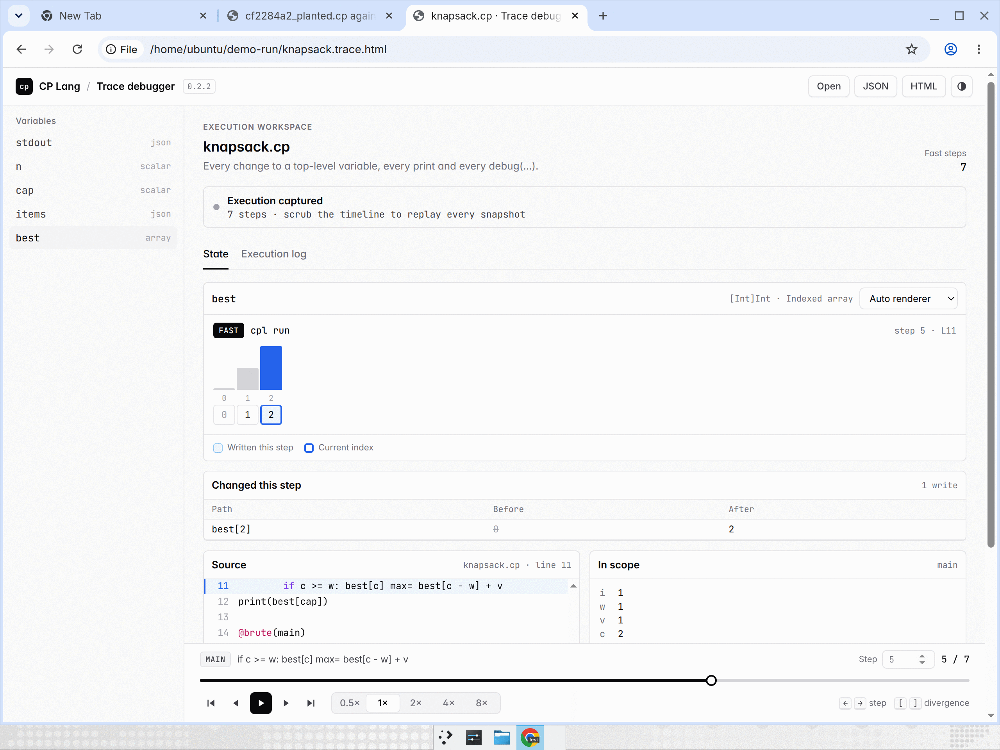
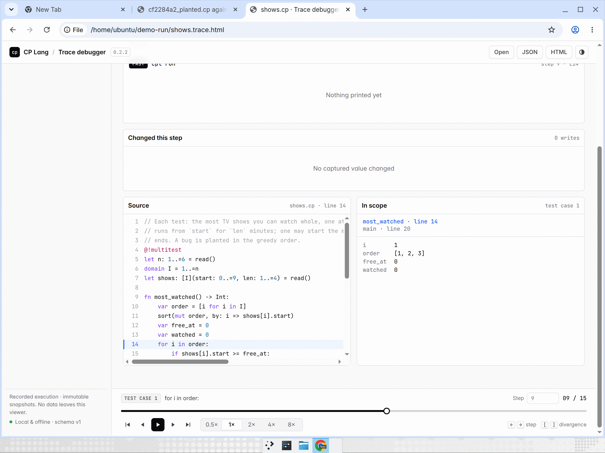
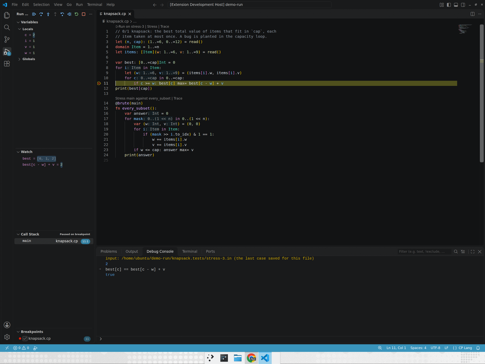

# Debugging demos: from a failing case to the first wrong state

Three small programs, each with one planted bug and an `@brute(main)`
reference in the same file:

| File | Kind | Planted bug |
|---|---|---|
| `knapsack.cp` | 0/1 knapsack DP | the capacity loop runs upward, so an item is taken twice |
| `shortest_path.cp` | Dijkstra on a graph | a vertex's distance is set once and never relaxed |
| `shows.cp` | `@!multitest` greedy | shows are sorted by start, not by end |

Every command below runs from this directory with today's default `cpl`
(no `CPL_SPEC`). The generated `*.tests/` and `*.trace.html` files are
ignored by git, so the demo starts clean each time.

## 1. `cpl stress` finds and shrinks a counterexample

```sh
cpl stress knapsack.cp --trace
```

```text
  brute: knapsack.cp (`every_subset`)      checker: none
  FAIL on case 3 (seed 3): WA
  shrunk from 10 numbers to 4:
    1 2
    1 1
  that is: n = 1  cap = 2  items = [(1, 1)]
  expected:
    1
  got:
    2
  trace knapsack.tests/stress-3.trace.html
  saved knapsack.tests/stress-3.in
```

The shrunk case is saved to `knapsack.tests/` and stays pinned to the file:
`cpl run --trace`, `cpl run --trace --live` and the VS Code debugger all use
it when no other input is given. `--trace` also writes the solution and the
brute side by side, lined up at each print.

The other two find theirs the same way:

```sh
cpl stress shortest_path.cp --trace   # roads (1,2,w=2), (1,2,w=1): expected 1, got 2
cpl stress shows.cp --trace           # shows (0,2) (0,1) (1,1): expected 2, got 1
```

## 2. `cpl run --trace` records the failing case

```sh
cpl run knapsack.cp --trace
# cpl: input knapsack.tests/stress-3.in (the case saved last for this file)
# cpl: wrote knapsack.trace.html (7 steps); open it in a browser
```

## 3. Open the HTML trace and find the first wrong state

Open `knapsack.trace.html` in a browser (it is one self-contained file). Step
with the arrow keys or the scrubber. With one item of weight 1 and value 1,
`best` should end as `[0, 1, 1]`. At step 5, line 11, `c = 2` reads
`best[1]`, which this same item already raised to 1, and `best` becomes
`[0, 1, 2]`: the item was used twice. That is the first wrong state.



- `shortest_path.trace.html`: `dist` and `adj` render as a graph. When the
  second road (1, 2, w = 1) is scanned, `dist[2]` stays 2.
- `shows.trace.html`: the locals of `most_watched()` show `order = [1, 2, 3]`
  after the sort; show 1 (0 to 2) is taken first and blocks both others.



## 4. Edit and re-run in place

```sh
cpl run knapsack.cp --trace --live
```

serves the viewer on localhost and records again on every save, on the same
pinned input. The page keeps its place (same line, same occurrence) and
marks the first step whose values or output changed. A save that does not
compile keeps the last good trace.

The fix is `for c in (0..=cap).rev:` on line 10. For the other two:

```text
shortest_path.cp   let near = d + road.w
                   if (dist[road.to] ?? (near + 1)) > near:
                       dist[road.to] = near
                       heap.push((near, road.to))
shows.cp           sort(mut order, by: i => shows[i].start + shows[i].len)
```

After the fix, `cpl stress <file>` reports that every case agrees.

## 5. The same in VS Code, with step back

Install the extension from `editors/vscode` (see its README), open this
folder, open `knapsack.cp` and press F5 (`CP: Debug File`). The debugger
records the run once on the pinned case, then moves through the recording:

1. Set a breakpoint on line 11 and press Continue: it stops at `c = 1`.
2. Add the watch `best` and evaluate `best[c - w] + v` in the Debug Console.
3. Continue to `c = 2`: `best` becomes `[0, 1, 2]`.
4. Step Back (or Reverse Continue) to see `best` as it was a step earlier.
5. Edit line 10, save and press Restart: the file is recorded again on the
   same input, the cursor returns to the same line and occurrence, and the
   console names the first step that changed.



While stopped inside a call, "Replay This Call" (on a call-stack frame, or the
lens above each fn) runs the edited fn once from the recorded entry state
(arguments, globals, input position) and reports its new return value and
first change. `shows.cp` is the example: stop inside `most_watched()`, fix
the sort key, save, and replay. The same engine is on the command line:

```sh
cpl replay shows.cp --trace shows.trace.html --step 13
```

A trap stops the debugger as an exception at the failing line, with the
values of that step.
