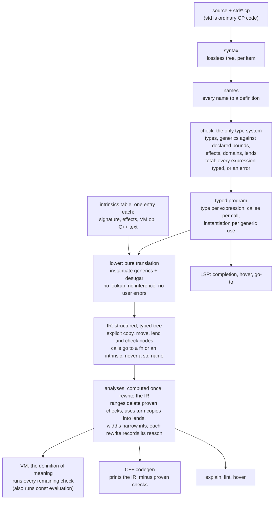

# RFC 0004: One type system, one IR, no privileged std

| | |
|---|---|
| Owner | compiler (Core) |
| Status | Draft |
| Ryan to review | yes |
| Changes | `handbook/design/architecture.md`, `handbook/design/compiler.md`, `handbook/design/codegen.md`, `handbook/design/architecture-invariants.md`, `scripts/debt-ratchet.py` |

## Summary

Every fact about a program is decided once, in the layer that owns it, and
everything after that layer reads the fact instead of working it out again.
Concretely:

1. The checker is the only type system. It is total: every expression it
   accepts has a real type. Lowering becomes a pure translation.
2. Std is ordinary CP Lang code. The only built-in operations are a small
   intrinsics table, and each intrinsic is defined once.
3. The IR makes every copy, move, lend and runtime check an explicit node.
   Analyses run once and rewrite those nodes (a proven check is deleted, a
   copy becomes a lend). `explain` prints the IR.
4. The IR and the VM are the definition of what a program means. Release
   C++ is the same program with proven checks removed, so the VM and C++
   must agree.

The tree-walker goes, and the factory shrinks to the few gates these rules
need.

## Problem

Read on `ee22d57db`.

**There are two type checkers.**

- `cpl-check` (44.6k lines) is "deliberately forgiving".
  `Ty::Unknown` is "compatible with everything, so missing knowledge never
  becomes an error" (`crates/cpl-check/src/ty.rs`).
- Lowering (`cpl-ir`, 55.7k lines) then "types every expression for real"
  (`crates/cpl-ir/src/lower/mod.rs`). It works from the syntax tree again,
  with its own name lookup, method resolution and generic instantiation.
  - It refers to syntax-tree nodes about 2,900 times.
  - It never reads the checker's `Facts`. It calls about 50 checker
    helpers (`Session`, `arity_key`, `builtin_members`, ...) and re-types
    expressions itself (`ir_reinfer` counts 12 `probe_expr` sites).
  - It has about 315 places that report errors of its own.
- `cpl_ir::check` runs lowering, up to 5 programs per file (main, judge,
  brute, gen, checker), just to find errors the checker let through.
- Generics are C++-style templates, checked only per instantiation.
  `Ty::erase` turns unbound type parameters into `Unknown`. 497 of 791
  generic declarations in `std/` have no bounds, and bounded ones use
  members their bounds don't give (`Fenwick<D, T: Add + Sub>` uses
  `T.zero`). The bounds themselves (`Add`, `Zero`, `Ord`, ...) are names
  hard-coded in the checker's prelude, not std traits.

The results:

- 21,227 expressions are typed `Unknown` with no diagnostic (9,452 of them
  in std).
- Errors agree, because the editor shows lowering's errors too
  (`cpl_ir::reported`). Hover and completion read only the checker and
  skip `Unknown` (`cpl-lsp/src/complete.rs`), so they come up empty.
- Every language rule has to be taught to both type systems.

**Each std operation exists in 4–6 places.**

- The IR's `Builtin` enum has about 64 variants. It is matched at 251 sites
  in `cpl-ir`, 129 in `cpl-interp` and 233 in `cpl-codegen`.
- `Min`/`Max` alone is handled in 18 files: six in lowering, the
  tree-walker, the interpreter's builtins file, four VM files and six
  codegen files.
- Lowering matches 111 distinct std names by string (`"len" | "size" |
  "count"`, `"print"`, ...).
- The checker keeps hard-coded tables (`builtin_members`, `std_methods`,
  `domain_members`) that lowering reads.
- Adding a std feature takes coordinated edits in five crates. Missing one
  of them is how the interpreter and C++ come to disagree.

**Analyses are computed several times.**

Range and proof facts live in six places:

- the checker's facts;
- `cpl-prover`;
- `cpl-lint/rules/proven` ("a second copy of facts the checker owns");
- `cpl-ir/lower/range.rs`;
- `cpl-codegen/ranges.rs` and `bounds.rs`;
- `cpl-codegen/scope/narrow.rs`.

Lends live in `check/lends.rs`, `lower/stmt/lends.rs`, `codegen/lend.rs`,
`lent_fields.rs` and `uses/`. When the copies disagree, a lint says
"proven" while codegen still emits the check, or the other way round.

**The factory measures the symptoms.**

- `scripts/` is 34k lines.
- There are about 145 debt counters, many of them regexes over source or C++
  text.
- In the last 4 days, 1,980 of 12,374 commits were factory or plan work.
- The last copy-counter "regression" was two regex detectors disagreeing,
  not a code change.
- Counters such as `ir_reinfer`, `silent_unknowns`, `std_shadowed` and
  `vm_fallbacks` count consequences of the three problems above.

## Proposal

### The pipeline

### What each layer owns, and may not do

| Layer | Owns | May not |
|---|---|---|
| Syntax | A lossless tree, comments and layout included, shared by the formatter, lints and editor | Drop anything a fix or the formatter needs |
| Names | Every name resolved to a definition, once | Be redone by the checker or lowering |
| Checker | Every type, generic check, effect, domain and lend | Leave `Unknown` in code it accepts |
| Typed program | The checker's answer: a type per expression, a callee per call, an instantiation per generic use | Be rebuilt by anyone else |
| Lowering | Instantiating generics, desugaring patterns, `match`, comprehensions and generators | Look up names, infer types, or report user errors (only "not supported by this back end") |
| Intrinsics table | The only built-in operations: arithmetic, memory, I/O, sort, about 20 | Grow without a reason only the runtime can provide |
| IR | The structured, typed tree the VM and C++ share, with every copy, move, lend and check explicit | Contain a std name as a string, or leave a copy or check implicit |
| Analyses | Each fact, computed once, applied as a rewrite of the IR | Be re-derived by codegen, lint, the VM or the editor |
| VM | What a program means, including const evaluation | Differ from C++ on any program that doesn't trap |
| Back ends | Running (VM) or printing (C++) the IR | Special-case a std function, or decide a copy or check |

These rules are enforced by types and module visibility, not by counters:

- Lowering gets no diagnostic sink for user errors.
- IR calls are `FnId` or `IntrinsicId`.
- `Ty::Unknown` is not representable in the typed program.
- Analysis results are reachable only through the analysis module.

### Explicit copies, moves, lends and checks

Lowering emits every copy, move, lend and runtime check (index, overflow,
range, `!` on `none`) as its own IR node, the conservative version first.
Analyses then rewrite: the range analysis deletes a check it proves, the
uses analysis turns a copy into a lend or a move, width analysis narrows an
int. Each rewrite records its reason.

So:

- `explain` prints the IR as it is. It cannot disagree with the C++,
  because both read the same nodes, and copy counters become unnecessary.
- The VM runs every check that is left. C++ prints the same nodes. No back
  end decides on its own whether something is copied or checked.

### The VM is the definition, and C++ must agree

The IR and the VM define what a program means. Every spec example runs on
the VM as a conformance case. Release C++ is defined as the same IR with
proven checks removed, so the contract is: on any input where the VM does
not trap, the C++ prints the same output. The differential and three-way
fuzz suites test exactly this contract, with no ignored failures.

### One evaluator

Constant evaluation (domains, array sizes, `const`) runs on the VM. The
checker, `cpl-prover` and lowering keep no evaluators of their own.

### The value model

The design assumes, and makes permanent, CP Lang's value model:

- Every value is copied, moved or lent. There are no references.
- Lends are second-class: they live for one call or projection and are
  never stored.
- Which of the three happens at each use is decided once, by the uses
  analysis, and written into the IR as a node.

### Effects are declared

Whether a function does I/O, may trap, or writes globals is part of its
type, declared on std functions and intrinsics and inferred for local ones,
and checked by the checker. `effects.rs` stops guessing after the fact.

Laws that optimizations rely on (`@law(assoc)`, `@law(comm)`) are tested
automatically by `cpl stress` with generated inputs, so a wrong law fails a
test instead of miscompiling.

### Modules and libraries

Libraries ship as source. Because generic bodies are checked once against
declared bounds, a library is checked once, when it is written, not each
time a program uses it. A program that uses a library still compiles to one
C++ file for the judge. Packages and versioning build on this, and are
designed in their own RFC.

### Generics: bounds are declared, and checked at the definition

Decided by Ryan. A generic declares the traits it uses, and its body is
checked once against them, as in Rust:

- `Add`, `Sub`, `Zero`, `Ord`, `Seq` and the rest become ordinary traits in
  `std/`, not names in the checker's prelude.
- Every std generic declares its bounds. The docs show them.
- A body that uses a member no bound gives is an error at the definition.
  The checker offers the missing bound as a one-step fix, so a contest
  generic stays quick to write.
- The checker still instantiates, so it records the callee and types for
  each instantiation in the typed program. Lowering resolves nothing.

### Facts carry their reason

Consumers want different things from a fact. Codegen wants yes or no and the
interval. `explain`, lint and hover want why. So each fact, and each rewrite
it causes, carries its provenance (the bound, loop or proof it came from).
Facts are computed only when some consumer asks: `cpl run` doesn't pay for
codegen-only facts, and `cpl-prover` stays behind the shared layer, so
compile speed holds.

### One incremental database

The incremental `Database` (`crates/cpl-check/src/db.rs`) already serves
`cpl check`, `run`, `build` and `lsp`. It memoizes syntax, definitions and
checks by item text and dependency fingerprints. It grows to own the whole
pipeline:

| Query | Keyed by |
|---|---|
| Syntax, definitions, checked item | Item text and dependency fingerprints (today) |
| Typed program for an item | The checked item |
| Lowered IR for one instantiation | The typed item and its type arguments |
| Each analysis (ranges, lends and uses, effects, widths) | The lowered IR it reads |

So the editor reads ranges, copies and effects from the same warm database
the build uses. A keystroke recomputes only the items, instantiations and
facts it changes, which is how a total checker stays fast in the editor.

Whole-program steps (devirtualization, inlining decisions, C++ emission)
stay one pass at build time, over cached per-item results.

### Why a typed tree and an IR

These are two forms, not two type systems:

- The typed tree is the lossless syntax tree plus the checker's tables (a
  definition for each name, a type for each node). It keeps the source's
  shape and generic `T`, for hover, completion, diagnostics and fixes.
- The IR is monomorphized and desugared, with copies and checks explicit,
  for the VM, C++ and `explain`. Each IR node keeps a span back to the
  source.

Rust (HIR and MIR) and Swift (AST and SIL) split the same way.

### Why keep the structured IR

The IR stays a structured tree (`If`/`While`/`For`/`Break`), not a new
control-flow-graph or SSA IR.

- Codegen prints readable, structured C++ from it, and users read that C++
  through `explain`.
- About 55k lines of codegen and the 21k-line VM already consume it.
- The goal, each analysis computed once and shared, works over this tree.
  `codegen/uses/` already presents itself as the single source for lends,
  copies and moves.
- A control-flow graph would mean rebuilding structure from a graph, and
  rewriting both back ends for no gain the tree can't give.

### Std

Std functions are CP Lang source, checked against their bounds like user
code and lowered like user code.

Optimizations that today key off a std name key off facts declared in std
instead. A plain CP `fn min` tells the range analysis nothing, so std needs
a small way to state such facts: laws (`@law(assoc)`, `@law(comm)`) and
range rules on a function's result. The analyses read those, never names.

A function stays an intrinsic only when CP Lang can't express it, or its
performance or readable C++ (`std::sort`, `std::min`) needs the runtime.
Expect 30–40 intrinsics. Each keeps a C++-text field so `explain` stays
readable.

## Decisions that lock in at release

Compiler internals can be rewritten later. These can't, and this RFC fixes
them now: the value model, declared generic bounds, declared effects, the
VM as the definition with C++ agreeing, and libraries as source checked
once. Editions (a language version per file with automatic migration) are
deferred to a later RFC.

## Order

0. **Split name resolution out** of the checker and lowering into one
   pass, and make the syntax tree lossless (comments are kept today, but on
   the side).
1. **Make the checker total.** Move `Add`, `Zero`, `Ord` and the rest into
   std as traits, declare bounds on std's generics, and check generic
   bodies against them. Close the 21,227 silent unknowns by root cause,
   starting with names (8,636) and members (3,962). Add the typed program,
   with each instantiation, as the checker's output. Exit when
   `silent_unknowns` is 0 and check time stays within a set budget.
2. **Move lowering onto the typed program, one construct at a time.** Each
   step deletes lowering's own lookup or inference for that construct.
   Lowering's syntax-tree lookups ratchet to 0.
3. **Replace `Builtin` with the intrinsics table.** First decide the
   syntax for laws and range rules in std. Move each remaining std
   name into `std/*.cp` as it goes. The `ir_builtin_names`,
   `std_names_outside_rt`, `prelude_privilege`, `std_shadowed` and
   `backend_std_names` counters reach 0 and are deleted.
4. **Make copies, moves, lends and checks explicit IR nodes,** and merge
   the analyses into one layer of rewrites over the IR. Delete
   `cpl-lint/rules/proven` and codegen's own range, bounds and narrowing
   analyses. `explain` prints the IR, and the copy counters are deleted.
   Move constant evaluation onto the VM.
5. **Delete the tree-walker.** It is already under way, and steps 2–3
   remove most of its remaining routes.

Every step has a safety net before it deletes anything: the old path and
the new path run side by side on conformance, the corpus and the fuzz
suites, and must give the same C++ output and VM traces.

Once lowering can't report user errors, `cpl_ir::check`'s extra lowerings
go away, and the checker alone covers the judge, brute, gen and checker
programs.

Steps 1–2 and 3 can run in parallel. Step 4 follows 2. Each new query is added to the
database as the step that creates it lands.

## Factory after this

The factory keeps a small gate:

- conformance;
- the differential and three-way fuzz suites, with no ignored failures;
- time, memory and size budgets;
- one counter per "may not" rule above, until that rule is enforced by
  construction. Then the counter is deleted.

Counters that only measure consequences of the three problems are deleted
when their cause goes.

## Open questions before public release

These could force changes to this design and are not answered here:

- **User libraries and modules.** Checking generic bodies once against
  their bounds is the prerequisite, but packages, separate checking and
  versioning are not designed.
- **Debugger and trace.** They must hook the VM's view of the IR, not the
  tree-walker's.
- **A native back end.** LLVM or a JIT instead of C++ would need a
  lower-level form under the structured IR. Judges accept C++, so this is
  after release.

## Not yet measured

- How many of the 21,227 unknowns are generic bodies, and how many are real
  checker gaps.
- How much work it is for the checker to record instantiations that today
  only lowering computes.

Step 1 starts by measuring both on `std/graph.cp`, `seq.cp` and
`tree.cp`, which have the most unknowns (1,168, 946 and 862).
