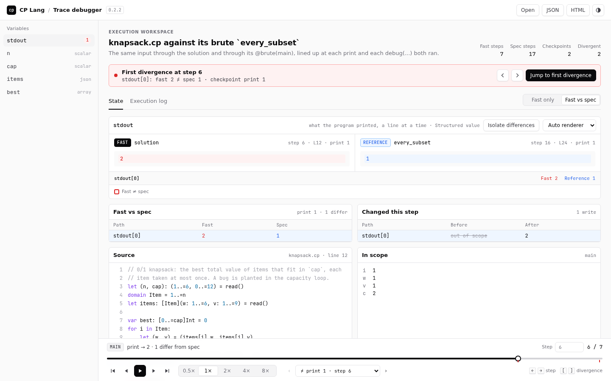
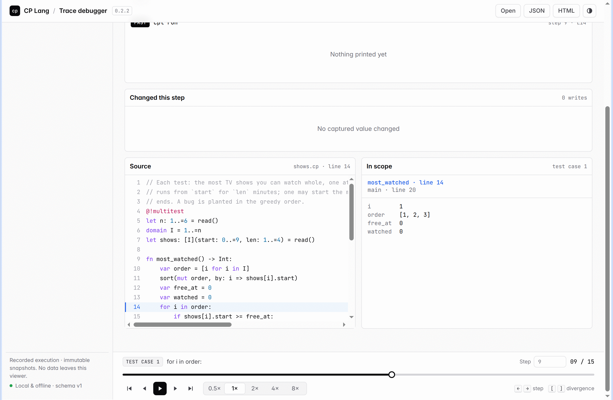
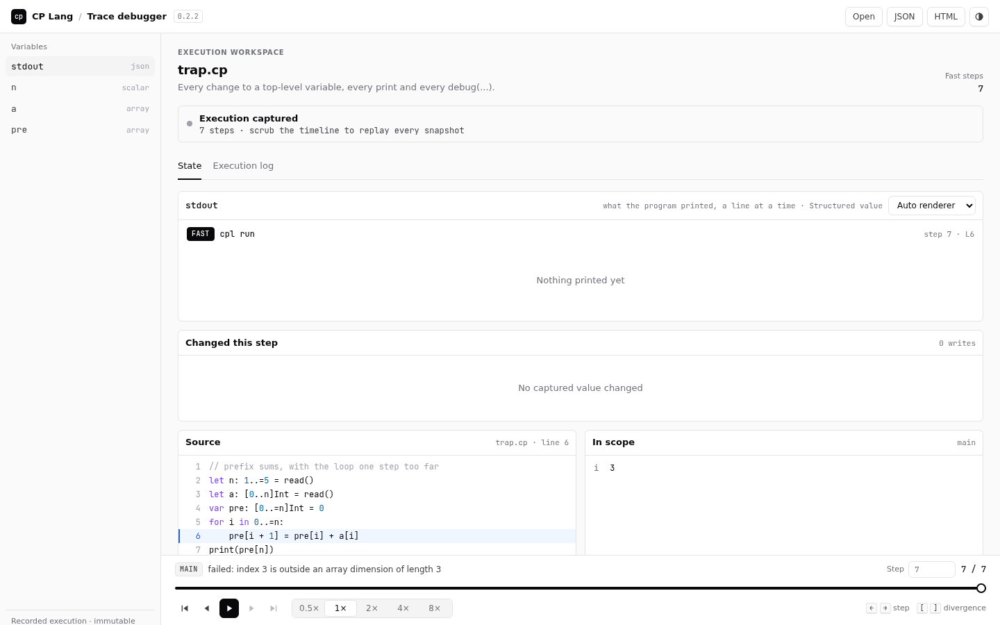
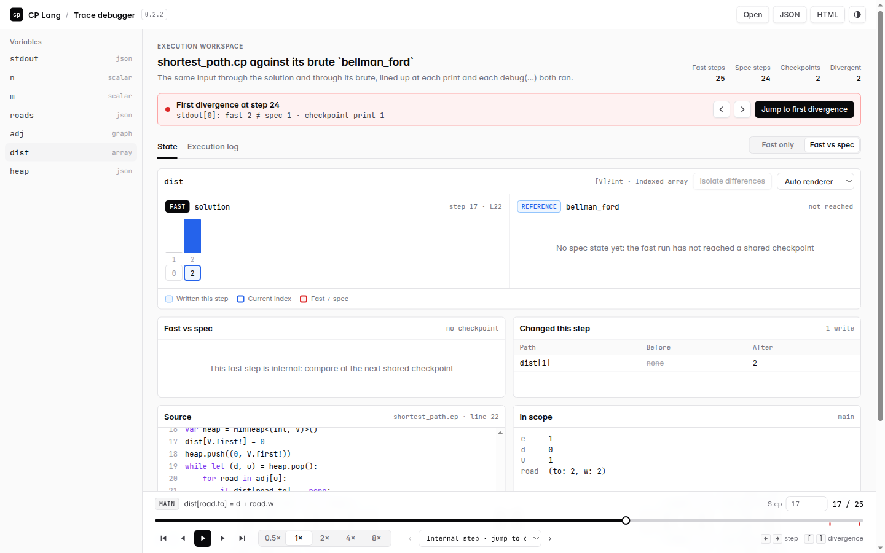
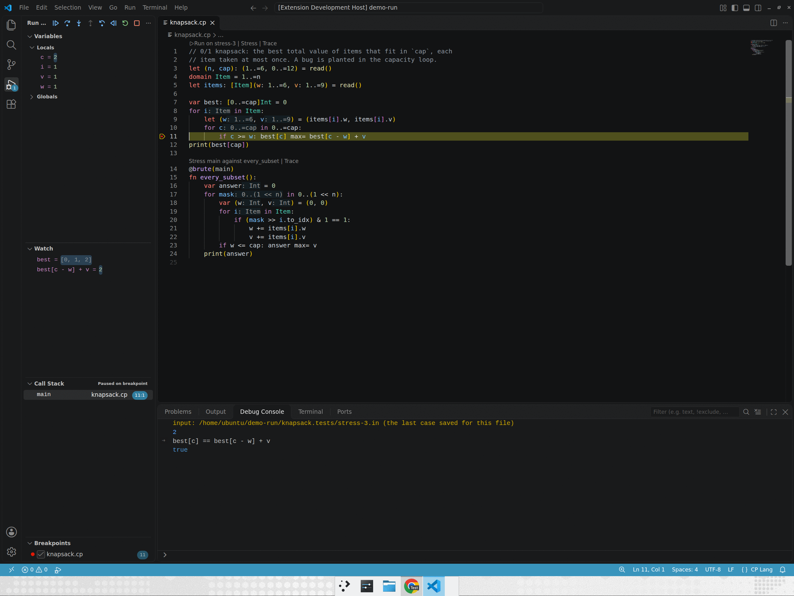

# debugger

Segment: E. Experience. One page; detail in [PLAN.md](PLAN.md), code in [ARCHITECTURE.md](ARCHITECTURE.md), numbers in [metrics.toml](metrics.toml), log in [worklog.md](worklog.md).
Owns: `crates/cpl-stress`, the trace (today inside `crates/cpl-interp/src/trace*`, to become `crates/cpl-trace`), the viewer (today `tools/trace/`, planned `web/packages/trace-viewer`), `examples/debugging/`.
Status (2026-11-22): stress is fast and green; the trace works end to end but recording is 5-6x slower than an untraced run against Ryan's +20% target; traps name their locals; the three v0.3 demos compile.

## Mission

Doubt to evidence: from "WA, and I don't know why" to a minimal counterexample, the first state that went wrong, and a trace you can scrub, in seconds, deterministically.
The loop Ryan reviews: **WA -> `cpl stress` -> minimal input -> trap or first divergence -> HTML trace / step back.**

## Milestone 1

Due about 09:30 PST 11/23, on edge; checkpoints every 2 h in the [worklog](worklog.md). What [MILESTONE-1](../../product/MILESTONE-1.md) needs from this domain: the loop **WA → `cpl stress` with a brute in the same file → minimized counterexample in seconds → fix → rerun**, smooth from the CLI, Neovim/Vim, VS Code and JetBrains, on Linux, macOS and Windows. Exit criteria:
- [x] The loop passes end to end on the CLI for `@alt(program)`, `@check` and `@interactor` multitests (`cargo nextest run -p cpl-cli --test debugger`: `stress_loop` tests).
- [x] Every seeded bug (`bench/stress/`, 29) found and shrunk; median < 1 s, max < 5 s (`cargo nextest run -p cpl-cli --test seeded_bugs --no-capture`: median 0.24 s, 11 of 11 P0 classes).
- [x] A cold run on 3 problems written fresh for it (`bench/stress/cold-*.cp`: max subarray, pair sums, increasing runs): each WA found and shrunk to a minimal case in 0.54-0.70 s, `cpl test` fails on it, and after the one-line fix `cpl test` and `cpl stress` pass (about 1 s). Run by debugger, not a stranger; the stranger run is Milestone 2.
- [x] The loop tests pass on Linux, macOS and Windows CI: paths, CRLF in saved cases, no `g++` or `sh` needed for a same-file brute (`.github/workflows/debugger-loop.yml`: 41 of 41 on each OS).
- [x] Neovim (headless loop `editors/neovim/test/stress_loop.lua` green on ubuntu, macOS and Windows in `debugger-loop.yml`; Vim's `stress_loop_vim.sh` green on ubuntu and macOS): `:Cpl stress` (or the LSP Stress lens) then `:Cpl test` runs the loop from the documented one-step setup (`editors/neovim/plugin/cplang.lua`); Vim: `:!cpl stress %` then `:!cpl test %`, documented. Tools owns `editors/` and the LSP; debugger writes the scenario.
- [x] JetBrains (`CpPluginSmokeTest` stress-loop test, headless IDE, green on ubuntu, macOS and Windows in `debugger-loop.yml`): a `cpl` run configuration with command `stress`, then `test` (`editors/jetbrains/src/main/kotlin/dev/cplang/ide/CplRun.kt`), runs the loop; its output names the saved case.
- [x] VS Code (loop test in `editors/vscode/test/integration/suite.ts` passes on ubuntu, macOS and Windows in `debugger-loop.yml`): Stress lens shows the failing case, Run All Samples reruns `<file>.tests/`; wording is v0.3's (`@alt(program)`, `@check`).
- [x] Traps name the rule, the place and the locals (all 12 R-codes in `runtime_errors.rs`).
- [x] Stress guide (`web/content/docs/guides/stress.mdx`, site's) teaches the whole loop including the rerun (section "The loop"); its examples run (they do today).

Milestone 1.5, started the moment the loop above works on all 3 OSes and in all 3 editors: replay (time travel, the +20% trace target) per [design/trace-replay.md](design/trace-replay.md), needing compiler's Interp snapshot/restore. Deferred past both: the `crates/cpl-trace` split, the VM in the browser, `gen<T>` generators beyond a row, DAP and viewer polish. What works stays working.

Every criterion above passes, so Milestone 1.5 has started.

Next:
1. Milestone 1.5: replay. Time travel already runs in every editor under test: VS Code and nvim-dap step back through `cpl dap` (`suite.ts`, `dap_loop.lua`), JetBrains through the trace view (`CpPluginSmokeTest`). Replay first goes from the start of the run to a trace window (compiler's option (a)); checkpoints wait for the VM's explicit frame stack.
2. `@gen` interpreted when no C++ compiler exists (General fixes owed).

## Milestone 2

The most ambitious complete version ([MILESTONE-2](../../product/MILESTONE-2.md)): any doubt becomes evidence in seconds, in every editor and OS, for strangers. Exit criteria:
- [ ] Time travel: any step of any run (single, multitest, interactive) is reachable backwards and forwards in the CLI, the viewer and DAP (VS Code, JetBrains, nvim-dap), via replay; trace overhead at most +20% over the interpreter, which is itself within 5x of C++ (`trace_budget` test, ungated today).
- [ ] Inputs of any structure are generated and shrunk: trees, graphs, strings, permutations, queries, via `gen<T>` for user types with no std privilege (`core-06/gen-*` 6 of 6 conformance).
- [ ] "Where do they first disagree": stress reports the first diverging line and value between solution and `@alt`, not just outputs. Today: `cpl stress --explain` names the first differing value (`@alt(program)`) or the first call of a part its `@alt(f)` answers differently, with its arguments, innermost in a recursion, and the solution's last own steps in it with their locals (`stress_explain_names_the_first_call_of_a_part_its_alt_answers_differently`, `..._innermost_wrong_call_of_a_recursive_part`); not yet a line-by-line match against the alt's steps, which have no common lines.
- [x] Seeded bugs cover all 11 P0 classes, every one found and shrunk, median < 1 s (29 bugs, median 0.24 s; `io-flush` is `guess-unread-verdict`, a judge verdict left unread).
- [ ] Traces stream in `crates/cpl-trace`; the viewer runs in the browser playground on the same VM; one vocabulary across trace, errors and spec.
- [ ] A cold stranger debugs 3 planted bugs from the docs alone, in every editor.
Next steps: replay (M1.5) on compiler's snapshot/restore; `Gen` with compiler; the divergence report.

## Covers / not covered

| Covers (debugger) | Not covered (owner) |
|---|---|
| `cpl stress`: typed-input generation, `@alt`/`@gen`/`@check`/`@interactor`, shrinking, seeds | The language rules for those decorators: `spec/lib/random-stress.md` (spec) |
| Trace recording, step back, replay of an edited call (`cpl run --trace`, `--live`, `cpl replay`) | The interpreter and VM the trace hooks into: `crates/cpl-interp` (compiler) |
| DAP time-travel debugger (`cpl dap`) and its behaviour | The VS Code extension that hosts it: `editors/` (tools) |
| The trace viewer (`tools/trace/index.html`) and its tests | Embedding it in the site and the playground UI: `web/` (site) |
| Trap evidence: which locals and call path a trap shows | Diagnostic wording and rendering: diagnostics |
| WASM trace/stress entry points in `crates/cpl-wasm/src/lib.rs` | The wasm build, size cap, deploy: site / infra |
| Seeded-bug and stress-budget benchmarks (`bench/stress/`) | `cpl profile`, `cpl bench`: perf / tools |

## Success criteria for v0.3

1. Every seeded bug, at least one per P0 class, is found and shrunk to its minimal input; median < 1 s, asserted in the gate.
2. Every trap prints the rule, the place, the offending locals and the call path in source terms (`spec/tools/trace-debug.md`).
3. Tracing a 10^7-step run stays inside the budget test: at most 1.2x the untraced run (Ryan: "at most like +20% to interpreter speeds"), < 500 MB, step back < 50 ms. Tracing off costs nothing: the interpreter is built once over a no-op observer.
4. The three `examples/debugging/` demos compile on v0.3 and run the whole loop; their screenshots are current.
5. The viewer has a browser test in `scripts/check.sh`; the playground's Trace works on every runnable docs example.
6. One trace engine: `CPL_TRACE_ENGINE=tree` and its parity test are gone, replaced by recorded goldens. The goldens are in (`crates/cpl-cli/tests/trace_goldens.rs`); both engines are held to them, and `CPL_TRACE_ENGINE=tree` goes once the browser traces on the VM.

## Milestones

- **M1 Green loop on v0.3.** Exit: `ten_million_budget_test` no longer fails on compile; `debug_demos_compile` 3/3 with `@alt(program)`; in-flight branches landed or deleted (`git cherry` notes in the worklog); seeded median asserted; viewer unit tests in `scripts/check.sh --fast`.
- **M2 Traps show values.** Exit: `trap_terminal_locals` prints `i = 3` and the call path for `probes/prefix_trap.cp`; a `runtime_errors` case per trap code (R01xx) asserts the locals; the viewer header names a trapped run "Trapped at step N"; seeded bugs grown to cover every P0 class.
- **M3 Fast trace, own crate.** Exit: `crates/cpl-trace` exists with the recorder, log and replay, depending on a narrow observer interface from `cpl-interp` (contract test next to the core); the tree trace engine deleted; recording at most 1.2x the untraced run; viewer browser test in the gate.

## Metrics

All run 2026-11-22 on main `4b8f504f`, release build; commands in [metrics.toml](metrics.toml).

| Metric | Today | Target | M |
|---|---|---|---|
| Seeded bugs found + minimal | 21/21 | all, ≥ 1 per P0 class | M2 |
| Seeded median time to minimal | 0.72 s (max 1.29 s), not asserted | < 1 s, asserted | M1 |
| Stress budget problems | 3/3, max 0.60 s | all < 10 s | M1 |
| 10^7-step budget test | **FAIL** (demo E0301) | pass | M1 |
| Trace overhead vs untraced | 6.10x scalar, 6.01x array (2026-11-22) | ≤ 1.2x (Ryan) | M3 |
| Tracing off vs before the observer | 0: plain runs use the no-op observer (113.5 vs 121.6 ms, noise) | 0 | M3 |
| Trace ops dispatched, hook bodies empty | 1.30x / 1.49x | (why hooks-on can't reach 1.2x: replay) | M3 |
| Interpreter vs C++ `-O2`, 10^7-iteration loops | 16.4x scalar, 33.2x array | ≤ 5x (Ryan; interpreter speed is compiler's) | M3 |
| Recording vs observed-only run | 1.67x | ≤ 1.5x | M3 |
| Trace memory at 10^7 steps | 230 / 361 MB | < 500 MB | M1 |
| Step back, worst | 20.5 / 74.7 µs | < 50 ms | M1 |
| Trace goldens | pass, 197 programs | pass | M1 |
| Debugger suites (8 binaries) | pass, 47 tests | pass | all |
| `cpl-stress` unit | pass, 83 tests | pass | all |
| Viewer unit tests | 62/62 in gate; browser test of 3 demos, skipped without Chrome | in gate + browser test | M1/M3 |
| Debug demos compile | 2/3, all spell `@brute` | 3/3, `@alt(program)` | M1 |
| Locals printed with a trap | 0 | offending locals + call path | M2 |
| wasm gzip (trace+stress inside) | 1,761,196 B | ≤ 2,100,000 B | all |

## Judgment rubric

Numbers can't say whether the evidence is the evidence a contestant needed. Each question has a probe a cold agent attempts with only the docs and the CLI.

1. **Is the first screen the answer?** After `cpl stress --trace`, does the first view show the divergence and the line responsible, without scrolling? Probe: given `examples/debugging/knapsack.cp`, name the buggy line from the trace alone in ≤ 3 actions.
2. **Is the minimal input actually explanatory?** Probe: for 5 seeded bugs, the agent states the bug from the shrunk input plus trap/trace only, never reading the brute.
3. **Does a trap need a rerun?** Probe: `probes/prefix_trap.cp`; can the agent fix it from the terminal output alone, with no trace and no `debug(...)`?
4. **Is the loop guessable from the docs?** Probe: a fresh WA solution and no instructions beyond the site docs; does the agent reach `cpl stress` and a minimal input without help?
5. **Does it stay out of the way?** Probe: the agent adds a dimension to a DP that has an `@alt(program)` brute; does stress keep working with zero edits to the generator or the brute?

## Improve (highest impact first)

1. Fix the broken demo and land in-flight branches (`devin/wip-v03-debug-demos`, `devin/wip-stress-gen-alt`, `devin/wip-trace-raw-cells`); the budget test fails on main today.
2. Traps print locals and call path in the terminal; the data is already recorded (the trace shows `i 3` at the trap step).
3. Viewer: label trapped runs, drop the hard-coded `0.2.2` (`tools/trace/index.html` lines 7, 337, 855), say `@alt` not `@brute(main)`; put its tests and a browser test in the gate.
4. Trace overhead: raw cell writes and VM-native recording; observed-only hooks alone cost 3.98x today.
5. Split `crates/cpl-trace` out of `cpl-interp` behind an observer interface; delete the tree trace engine.
6. Generators for shapes a row can't say: graphs, trees, grids, anti-hash; shrinking in the browser.
7. Seeded bugs per P0 class, with the class recorded per bug.

## Decisions for Ryan

None open. Decided on their recommendations (decisions.md 272-274): tracing at most +20% over the interpreter (Ryan's target), tracing as a flag on `run` and `stress` plus `cpl replay` and `cpl dap`, and the viewer as one file in `tools/trace/`.

## Ryan's role

Align on the loop above and on what generators must describe; review rounds on screenshots and recordings of the loop (worklog). Current screens, recaptured 2026-11-22 from main with `cpl stress --trace` and `cpl run --trace`:

|  |  |
|---|---|
|  |  |
|  | |
