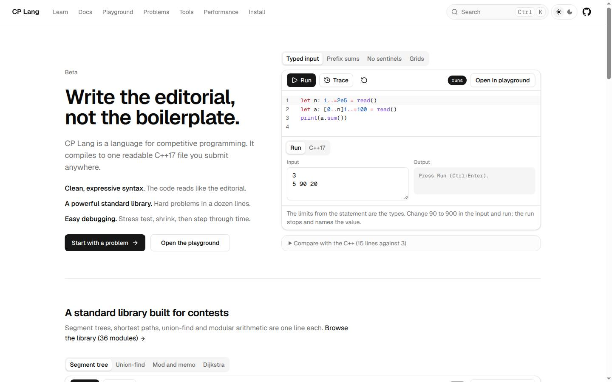
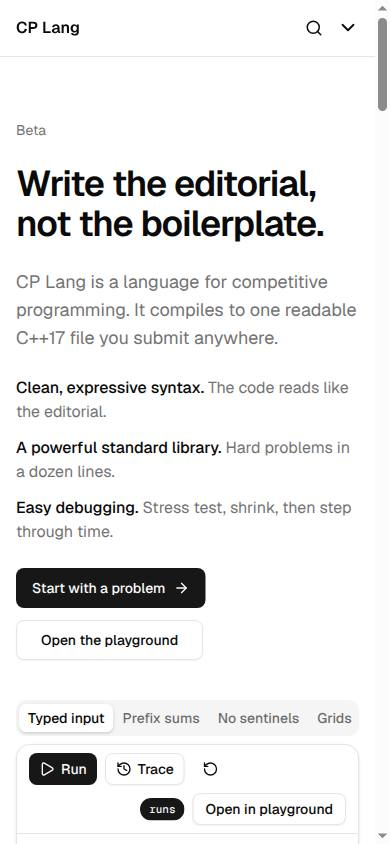
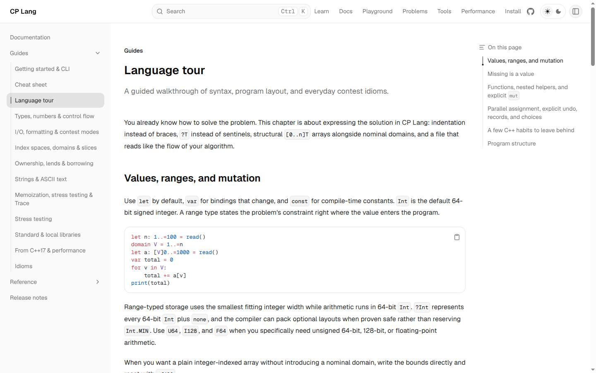
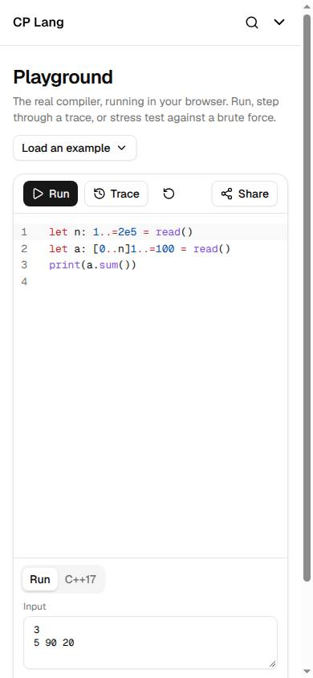

# site plan

The detail behind [README.md](README.md). Dated 2026-11-22.

## Where it stands

The site works: build, gate, typecheck, unit tests and both browser smokes pass, cp-lang.org serves every route, and the landing runner, trace replay, stress shrink and Learn judging all work in a real browser (numbers in [metrics.toml](metrics.toml)). What is missing is mostly *proof*: the domain's own bar (the docs-only eval) cannot run, the site checks are not in CI, and nothing caps size. The remaining product work is consistency and depth.

## Workstreams, in order

Ordered by [Milestone 1](../../../handbook/product/milestones.md): work that blocks steps 1-2 of its scenario (Understand, Try) or the way into step 3 (Install) comes first.

1. **30-minute intro (step 1). Landed.** One page, `/learn/intro`, built from `web/content/docs/guides/tour.mdx` and the cheat sheet: syntax, typed input, domains, optionals, the std, and testing, ≤ 4,500 words, every example a live runner. It ends at Practice and Install. The homepage's first call to action points to it.
2. **Language section (step 1, in depth; parallel to 1 and 3).** `/learn/language/`, 8 chapters: values, ownership and mutation (`mut`, aliasing, invalidation); domains, ranges and index spaces (range keys); types, widths and proofs; optionals; multitest state; checked operations and build profiles; stdlib design; the C++ and the judge model. Each one states its rules precisely in site prose that links the `spec/` section it follows (no copied spec text), has gate-run examples that run in place, and ends with "Why it's designed this way", citing `decisions.md` and the alternatives they rejected. The gate checks every cited spec heading and decision number, so a renamed section fails the build instead of drifting.
3. **Practice that teaches (step 2).** Pick at least 12 Div 2 A/B problems from the 21 that teach CPL's distinctive patterns. Give each a `hints` list (shown before acceptance, linking to the std docs or a guide). Lint live in the practice and playground editors through the wasm `lint` call tools landed (`25b19e064`).
4. **Homepage and install (steps 1, 3).** `/setup` landed (`30b229105`): edge on Linux, macOS and Windows; Neovim, Vim, VS Code and JetBrains in one step each. Next: `cpl setup neovim|vim` once edge ships it; the value proposition and 3 differentiators above the fold at 390 and 1280 px; Install in the header at every width; a P5 cold-read baseline.
5. **Docs examples all run (step 2).** The 7 `spec` snippets go to zero as the compiler lands them; each one left is badged and listed with its owner. Search finds every std item by name. The docs-only eval measures this once a model key or CI run exists.
6. **Keep green (standing).** Gate, links, phone pass, `/` page weight ≤ 800 KB with no wasm, search ≤ 500 KB, wasm cap.

Done before Milestone 1: land and gate (wasm cap, `scripts/site-check.sh`, link check); the UI pass (one nav, phone fit, landing tabs that run first); search 2.7 MB to 491 KB; live guide runners; Learn at 11 chapters and 21 problems; `cpl doc` HTML in the site's design; the trace viewer links back.

Deferred (milestone "what can wait"): interval DP and chapters past Div 2 C; trace viewer and `cpl doc` polish; 0.3-only landing tabs; Problems and Performance pages; size tuning beyond the caps.

## Why these milestones

- **M1 first** because every later round of Ryan's review rests on "main is green and what you see is what ships"; today a size regression or a broken link reaches cp-lang.org silently.
- **M2** is the mission bar. Without a fresh number every docs change is a guess; with it, docs work is a hill to climb.
- **M3** is the launch content. It depends on the compiler closing spec gaps, so it goes last and tracks their progress.

## Alternatives considered

- **Eval against the repo `spec/` instead of the served docs.** Rejected: it measures the spec, not the site; the cold reader sees cp-lang.org.
- **Server-side compile for share previews or slow devices.** Rejected: costs a service and a sandbox; the wasm worker already runs everything at 1.8 MB gzipped.
- **Drop Fumadocs search for an external index (Algolia, Pagefind).** Pagefind stays the fallback if trimming the Fumadocs index does not reach the target; no third-party service.
- **Hide `spec`/`checks` examples entirely.** Rejected for now: they show 0.3; the badge keeps them honest. Question 1 asks Ryan.

## Risks

- The eval depends on two other domains and a model key; if it stays down, M2 slips. Mitigation: a small local probe (P1, 3 problems) that site runs itself.
- wasm growth from compiler work can break the cap; the cap's failure message names the size and the owner.
- `prebuild` runs the full gate (about a minute with the release `cpl`); a slow gate slows every build. Cache by snippet hash if it passes 2 minutes.
- Generated reference shape is set by `cpl doc` (tools); layout fixes there may need tools changes.

## Phase 2, first moves

1. Rebase and land `devin/v02-delete-site-followup` through `scripts/land.sh`.
2. Fix the `/docs/guides/` target and wire `web/scripts/links.mjs` into the gate path.
3. File the eval and CI requests in the infra and idioms worklogs.
4. Start the UI pass with the nav and landing tabs, screenshots in the worklog.

## General fixes owed

Each row: the instance, the general fix, and who owns it.

- **Learn pages missing from `/llms-full.txt`** (95 chapters and practice problems; the bundle held only `/docs`). Fixed: the bundle adds the Learn course, and `web/scripts/llms-complete.mjs` fails the build on any exported docs or Learn page it lacks. Still owed (site): the five pages drawn from code (`/learn/start`, `/learn/from/*`) render into the bundle from the same data as their pages.
- **Lint examples that don't compile** (14 of 122 `before.cp`: removed spellings such as `xs.len()`, `.pow`, `prefix_n`, now compile errors, and `print(bool)` without `yes`), so their Flagged pane shows errors beside the lint and offers no Run. Site shows Lint on every example and Run only where `cpl check` passes with no input. General fix owed (lint-fmt): `record_tests.rs` also requires `before.cp` and `near_miss.cp` to pass `cpl check`, and a lint whose pattern is now a compile error (L0608 `parens_on_o1` is E0304) is retired. Filed in lint-fmt's worklog.
- **Practice refs that our own lints flag** (5 of 21 refs; hints taught the flagged form). Made general in the site gate: every practice `ref.cp` must lint clean and every problem needs a hint that links to the docs, a chapter or a lint. Still owed (site): lint every runnable docs and Learn snippet the same way, with an allow marker for snippets that show the flagged form on purpose.
- **`loop_reduction` says "is one `min`"**, but `min(e for ...)` is `E0303` and `(e for ...).min()` does not parse; refs use `[e for ...].min()` and `filter(p).max()`. General fix: generator arguments for `min`/`max`, as for `sum` (compiler/stdlib), and help text that names a spelling that compiles (lint-fmt). Filed in lint-fmt's worklog.
- **Record patterns `Add(x:)` do not parse** (R02.7.6, decision 230); the values chapter uses positional `Add(x)`. General fix: field patterns in the parser (compiler). Filed in compiler's worklog.
- **Generic trap messages for slice keys (`w[0]`, R04b.1.10) and `!` on `[V]?Int` (R02.4.8)**; the chapters explain them in prose. General fix: key-aware and gap-naming trap messages (diagnostics). Filed in diagnostics' worklog.
- **Std doc examples that don't run** (286 of 2,767; shown static). Site makes each one a program and runs it at build time. General fix: `cpl doc --test` runs examples, not just parses them, so stdlib's own check fails on a broken one (tools/stdlib). Filed in stdlib's worklog.
- **`cpl doc` dropped `pub` from fn signatures** (488 of 730), and the site guessed visibility from the signature text. Fixed in the extractor. General fix owed (tools): the JSON carries visibility as a field, so no consumer parses signatures for it.
- **`cpl.wasm` grew 15 KB gzipped over 66 commits and turned main's site build red only afterwards** (decision 440). No commit saw its own growth. General fix owed (infra): the commit tier, or CI on each push, reports each commit's `cpl.wasm` gzip delta, so a commit that adds more than about 1 KB names itself before the cap fails on main.
- **A new std example that doesn't type-check reached main** (`seq.step` in 5f6da2bb9; E0302 on `Stepped.collect()`), so main's site build went red and deploys stopped until it was fixed. gen-ref catches it only in the site build. General fix owed (infra/stdlib): the commit tier runs `cpl-conform docs <module>` for each std module a change touches, so a broken example fails before land.
- **Hover shows intra-doc links as code, not links.** Hover has no module for a std name, so it can't build the cp-lang.org URL. General fix owed (tools/lsp): hover carries the std module of the hovered item, then links render as `https://cp-lang.org/docs/ref/std/<module>#<anchor>`.
- **`/` went over its page-weight cap from a prefetch** (the 2,625-row std index, linked from the hero, plus KaTeX markup in its cost column). Fixed locally: plain-Unicode costs in that table and `prefetch={false}` on the link. General fix owed (site): `page-weight` reports prefetched payloads per link and fails when one linked page's prefetch is over 100 KB, so a heavy page can't silently grow `/`.
- **`cpl.wasm` size: cut and ratcheted.** Instance: 2,098,812 of 2,100,000 B gz. Done: stale-dist detection (`97cf73c08`), std comments blanked in the wasm (`ac6aa9701`, 1,913,207 B gz), cap lowered to 2,000,000 as a shrink-only ratchet that `wasm-size.mjs` prompts to lower after each cut. Owed (tools): split codegen/stress/explain/lint (~720 KB raw code of 4.8 MB) into a lazily loaded second module, and fetch non-prelude std text (~1.0 MB raw in `.rodata`) on first `use`. The profile is already z + fat LTO + 1 codegen unit + panic=abort; wasm-opt -Oz shrinks raw 13% but grows gz 0.8%, so it is no lever. Then split into `cpl.wasm` (editors) and `cpl-build.wasm` (codegen, explain, stress; loaded on first use; decision 376): 1,660,518 B gz, cap 1,720,000. Owed: a committed per-crate baseline from `wasm-size --why` so a failure names the crate that grew since the last ratchet; std source (1.11 MB raw data) fetched per module on first `use` is the next big cut (tools).
- **`cpl.wasm` per-feature growth.** Instance: +44 KB gz in an hour from new lints and LSP methods. General fix: a per-crate gz budget in `wasm-size.mjs` from a named build, so the lane that grows a crate sees it in its own check; next cuts: `cpl-diag` registry texts (95 explanations, triggers and fixes, only `cpl explain` reads them; ~8.5 KB gz, small) left out on wasm32 like lint texts, and the second lazy module for codegen/stress/explain (tools).
- **`cpl.wasm` at its cap again after every cut (decision 446).** Instance: 1,875,380 of 1,875,000 B gz locally at `7ed78a612`, growing about 4.5 KB gz per half hour from ordinary compiler and std work; interp at z and the lint-title table are spent. General fix owed (compiler, with site): the browser embeds all 42 std modules, 827 KB raw and about 172 KB gz, though `prelude.cp` and `mod.cp` are 3.5 KB gz of it. Keep the generated public-name index in `cpl.wasm` and fetch a module's text on its first `use`, which frees about 165 KB gz. The checker's scans over `std_modules()` texts (`prelude.rs`, `check/advice.rs`) would read the index instead. Site owns the fetch and the cache. Done: compiler's `lazy-std` (`94852a0e1`) and the site's fetch loop (`47eca6d17`), on by default in `build-wasm.sh` (decision 468): 1,762,047 B gz locally.

## Milestone 1

Ryan's [Milestone 1](../../../handbook/product/milestones.md) sets the priorities now; the v0.3 milestones and metrics below are means to it. Deadline: about 09:30 PST on 2026-11-23, so this plan is in hours. It ships on edge, Codeforces is the target judge (checked against the local `codeforces` profile, no real submissions), and Linux, macOS and Windows are all supported. Site owns scenario steps 1 (Understand) and 2 (Try), and the way into step 3 (Install).

What it needs from site, each checkable:
- **Homepage:** at 390 px and at 1280 px, the first screen says what CPL is, who it is for, and one runnable program. A cold reader names 3 advantages over C++ after 3 minutes (probe P5). Install is linked from the header at every width.
- **30-minute intro (landed, `e441044cd`):** `/learn/intro`, 12 sections, 17 examples that run in place, ending at Practice and Install.
- **Browser practice:** at least 12 hand-picked Div 2 A/B problems judged in the browser, each with hints shown before acceptance that link to the std docs or a guide, and lints shown live in the editor.
- **Docs:** search finds every std item by name, and every docs example runs; the gate reports `spec: 0`, or each spec-only block is badged and listed with its owner.
- **Install (`/setup`, landed `30b229105`):** one click from the homepage, the intro and the docs. It gives the edge one-liners for Linux, macOS (`install.sh`) and Windows (`install.ps1`), and one-step setups for Neovim, Vim, VS Code and JetBrains on all three platforms. Tested on Linux here; infra's acceptance run covers macOS and Windows. Once an edge build has `cpl setup neovim|vim`, the Neovim and Vim tabs lead with it.
- **Language section:** in-depth chapters for readers who want the whole model, next to the Learn path, not after it. One chapter per part: values, ownership and mutation; domains, ranges and index spaces (with range keys); types, widths and proofs; optionals; multitest state; checked operations and build profiles; stdlib design; how the C++ and the judge model work. Each one states the rules precisely, has examples that run in place, and ends with "Why it's designed this way", citing `decisions.md` entries and the alternatives they rejected. Rules link to their `spec/` section instead of copying it, and the gate fails if a cited spec heading or decision number does not exist.

Deferring (milestone "what can wait", or not on a scenario step; continues only after the blockers): interval DP and practice problems past Div 2 C; trace viewer and `cpl doc` polish; the 0.3-only landing tabs; the Problems and Performance pages; page-weight and search tuning beyond the existing caps.

Top 3 next steps:
1. Docs examples: the gate still reports `spec: 7` (blocks waiting on the compiler); badge and list each with its owner, or run them as the compiler lands them.
2. The P5 cold read of the homepage (3 advantages over C++ after 3 minutes), now that the program and Install are on the first phone screen.
3. Milestone 2: stress and trace in the playground (the error-code index landed: `/errors`, from `cpl explain --json`).

(Landed since the last list: practice hints before acceptance on all 21 problems, linked to docs and lints (`7fec61823`); all 9 Language chapters; the std reference with runnable examples, KaTeX costs and intra-doc links.)

Checkpoints go in [worklog.md](worklog.md) every 2 hours: what landed, what is next.

## Milestone 2

**The most ambitious version:** cp-lang.org stands on its own for a stranger. It teaches CP Lang from first program to the whole design, every page is generated from or checked against `spec/`, every example runs in the page, and every tool (check, lint, fmt, test, stress, trace, explain, build) works in the browser.

Exit criteria:
- The Learn path covers Div 2 A to Div 1 C, with at least 60 judged problems with hints, and the docs-only eval passes at least 50/55 from the site alone.
- The Language section has a chapter for every part of `spec/core/`; every rule it states links its spec section, and the build fails on a broken citation.
- The library reference, `/lints` and the diagnostics index are all generated: every item, lint and error code has a page with an example that runs.
- The playground has stress, trace viewing and `cpl explain`, and can share a link to a program.
- `/setup` shows stable and edge installs for Linux, macOS and Windows, labelled beta while 0.x; there's a changelog and release notes page per stable release.
- Health: `/` at most 800,000 bytes gzipped with no wasm, search index at most 600,000 bytes gzipped, 0 broken links, every route fits 390 px, and the site check runs in CI in under 3 minutes.

Next steps, once Milestone 1 passes: the error-code index generated from `spec/` diagnostics, Learn chapters for Div 2 C to Div 1 C, and stress and trace in the playground.

## Improve (highest impact first)

1. Restore the docs-only eval (needs the statement fetcher and a model key) and point it at the served docs; it is the domain's bar and cannot run today.
2. Run `scripts/site-check.sh` in CI (infra request filed); it is on main and green locally.
3. Search index: done, 2.7 MB -> 487 KB gzipped (reference pages index headings, intro and core table rows); 13 KB of headroom left.
4. UI consistency: the top nav sits left on Home/Play and right on Docs/Learn (two Fumadocs layouts); none of the 8 examples in the landing's syntax and library tabs has Run (they are `checks` or `spec`).
5. Guide code blocks live: done; every block that prints something has Run.
6. Learn: 11 chapters, 21 problems (greedy, graphs and DP added); next is a cold read of chapters 4-9 against the rubric, and interval DP once `V.ranges` runs (compiler request filed).
7. `cpl doc` HTML in the site's design: done ([screenshot](screenshots/cpldoc.jpg)); the trace viewer on the site links back: its brand goes to `/`, and at 1100 px and wider it shows the site nav (Home, Learn, Docs, Playground).

## Ryan's role

Review rounds on cp-lang.org (Worker preview per change once infra adds previews) with screenshots in the worklog; redirect any of the decisions below. Current screens: [screenshots/](screenshots/).

| Desktop | Phone |
|---|---|
|  |  |
|  |  |

More: [learn](screenshots/learn.jpg), [practice](screenshots/practice.jpg), [playground](screenshots/play-ran.jpg), [problems](screenshots/corpus.jpg).

## Decisions made

Site has no open questions for Ryan. Each call below was decided by its recommendation under Ryan's rule (reversible, in line with the goal), and is logged in [decisions.md](../../../decisions.md) as 261-263.

1. **Landing examples that don't run yet.** Decided: lead each landing tab group with runnable programs; spec-only ones stay as later tabs with the "0.3 spec" badge. Applied (reversible, `runsFirst` in `web/lib/landing.ts`): every landing tab group now opens on a program that runs.
2. **Guide code blocks become live runners.** Decided: yes, for blocks whose status is `runs`. Applied (reversible: drop `remarkLive` from `web/source.config.ts`): every guide block that runs has "Open in playground"; the 79 that print something also have Run ([screenshot](screenshots/guide-runner.jpg)).
3. **Learn for v0.3: breadth or depth.** Decided: a short course to Div 2 C, not a full course: 11 chapters (greedy, graphs and DP added on Ryan's scope) and 21 judged problems. Reversible: trim `web/content/learn/read/meta.json` and `practice/meta.json`, or revert the Learn commits.

## Known debt

- Search index 3.0 MB raw, 487 KB gzipped at level 9 (`web/out/api/search`, from `web/app/api/search/route.ts`): reference pages index their headings and intro only (core chapters also their table rows, without the repeated header), so prose inside a reference entry is not searchable; the tokenizer also indexes each part of a dotted name, so `last_true` finds `SortedBag.last_true`. Adds `zbsearch` (the version fumadocs-core uses) as a direct dependency for that tokenizer. The `search` step of `web/tests/smoke.mjs` guards a reference item, a guide heading and a core row. 13 KB under the 500 KB target: the next cut is per-entry term frequencies (140 KB gzipped of the index).
- Two layouts, one header order: `HomeLayout` on Home, Play, Performance, Tools and the Learn index; notebook `DocsLayout` on Docs and Learn chapters, whose header `notebookOptions()` (`web/lib/layout.shared.tsx`) and a `#nd-subnav` rule in `web/app/global.css` rearrange to match (title and links, then search and icons). The rule depends on Fumadocs' header markup; on a Fumadocs upgrade, check the docs header against the landing's. Phones still show two menu icons (chevron on Home layouts, sidebar on Docs).
- Browser smoke and `scripts/site-check.sh` are not in CI (`.github/workflows/site.yml` curls 4 routes only).
- The docs-only eval cannot run: `.github/workflows/writable-from-docs.yml` calls `scripts/fetch-statement.py`, deleted in `e4fc2a14`, and `corpus/statements/` is absent.
- Only 4 unit tests (`web/lib/extract.test.ts`, `web/worker/share.test.ts`); `runner.tsx` and the gate have none.
