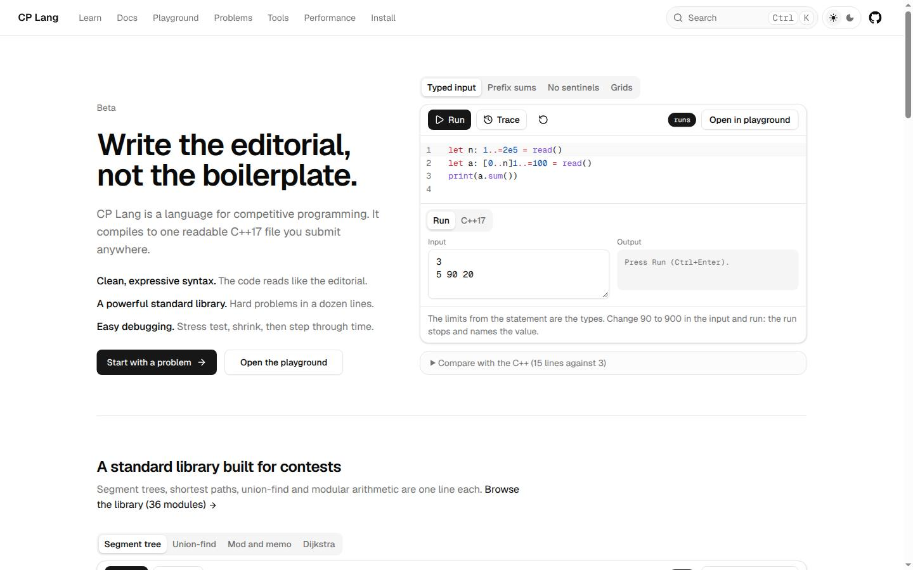
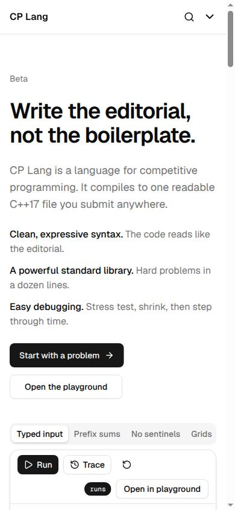
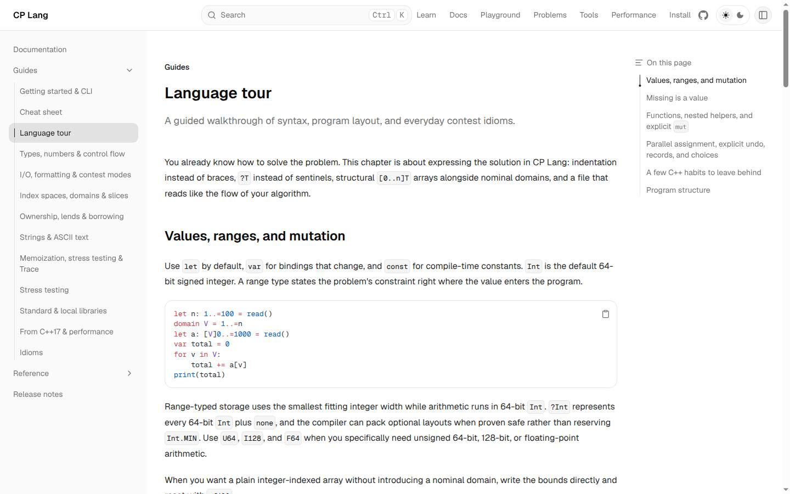
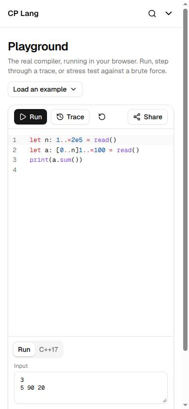

# site

Segment: E. Experience. Owns: `web/` (content, Learn, playground, share links, UI) and the snippet gate (`web/scripts/gate.mjs`). Status (2026-11-22): cp-lang.org is live and green: build, gate, typecheck, unit and browser smoke all pass. The docs-only eval (cannot run) and CI for `scripts/site-check.sh` are the gaps.

Detail: [PLAN.md](PLAN.md) · code: [ARCHITECTURE.md](ARCHITECTURE.md) · numbers: [metrics.toml](metrics.toml) · log: [worklog.md](worklog.md)

## Mission

A competitive programmer goes from "what is this" to an accepted submission they trust, from cp-lang.org alone. The bar: **a cold reader, person or model, writes correct CP Lang from the docs alone.**

## Covers / not covered

| Covers (site) | Not covered (owner) |
|---|---|
| Landing, Learn (read + practice tracks), guides, cheat sheet | Language rules themselves: `spec/` (spec) |
| Generated reference pages (render only) | `cpl doc --format json`, CLI help text: tools; std `///` docs: stdlib |
| Playground, in-browser Run / Trace / Stress UI, share links (`web/worker`) | The wasm compiler `crates/cpl-wasm`, stress engine, trace viewer: debugger / tools |
| Snippet gate: every program on the site is checked by the compiler | The gate's place in `scripts/check.sh`, CI, deploying cp-lang.org: infra |
| Docs bundle the docs-only eval reads | The eval harness `scripts/writable-from-docs.py` and statements: idioms / infra |
| Problems gallery, Performance page (render only) | `corpus/` (idioms), `bench/` data (perf) |

## Milestone 1

Ryan's [Milestone 1](../../product/MILESTONE-1.md) sets the priorities now; the v0.3 milestones and metrics below are means to it. Deadline: about 09:30 PST on 2026-11-23, so this plan is in hours. It ships on edge, Codeforces is the target judge (checked against the local `codeforces` profile, no real submissions), and Linux, macOS and Windows are all supported. Site owns scenario steps 1 (Understand) and 2 (Try), and the way into step 3 (Install).

What it needs from site, each checkable:
- **Homepage:** at 390 px and at 1280 px, the first screen says what CPL is, who it is for, and one runnable program. A cold reader names 3 advantages over C++ after 3 minutes (probe P5). Install is linked from the header at every width.
- **30-minute intro (landed, `e441044cd`):** `/learn/intro`, 12 sections, 17 examples that run in place, ending at Practice and Install.
- **Browser practice:** at least 12 hand-picked Div 2 A/B problems judged in the browser, each with hints shown before acceptance that link to the std docs or a guide, and lints shown live in the editor.
- **Docs:** search finds every std item by name, and every docs example runs; the gate reports `spec: 0`, or each spec-only block is badged and listed with its owner.
- **Install (`/setup`):** one click from the homepage, the intro and the docs. It gives the edge one-liners for Linux, macOS (`install.sh`) and Windows (`install.ps1`), and a one-step Neovim setup and a Vim setup next to VS Code. Its commands are the ones infra's install tests run on all three platforms.

Deferring (milestone "what can wait", or not on a scenario step; continues only after the blockers): interval DP and further Learn chapters past Div 2 C; trace viewer and `cpl doc` polish; the 0.3-only landing tabs; the Problems and Performance pages; page-weight and search tuning beyond the existing caps.

Top 3 next steps:
1. `/setup` for the milestone: edge as the default install on all three platforms, Windows PowerShell, Neovim and Vim in one step, with the stale "not published yet" badges removed.
2. Practice hints linking to docs, and live lint in the browser editor. The playground has no lints today: `crates/cpl-lsp` skips them on wasm because of the site bundle's size cap. `cpl-lint` builds for wasm, so site will measure the size and turn them on if the 2.1 MB cap holds, with a note to tools.
3. A homepage pass: the value proposition and 3 differentiators above the fold, Install visible at every width, and a baseline for the P5 cold read.

Checkpoints go in [worklog.md](worklog.md) every 2 hours: what landed, what is next.

## Success criteria for v0.3

1. Every program on the site is v0.3, compiler-checked at build time, and has Run only if it runs: gate `spec: 0, checks: 0`.
2. `scripts/site-check.sh` green on main and in CI: wasm build, size caps, build, gate, links, browser smoke.
3. Docs-only eval: a model given only the served docs passes ≥ 95% of the 55 unseen problems.
4. Zero open layout bugs at 390 / 768 / 1440 px, light and dark, every route.
5. Learn covers the language a Div 2 A-C needs: 11 read chapters (greedy, graphs and DP included), 21 judged practice problems.

## Milestones

- **M1 Green and honest.** Exit: `scripts/site-check.sh --no-cache` prints `site-check: ok` on main; CI site workflow runs it; `pnpm --dir web links` 0 broken; search index ≤ 500 KB gzipped; one nav layout on every page; a written UI pass (3 widths × 2 themes) with 0 open bugs and screenshots.
- **M2 Writable from the docs.** Exit: the eval runs on demand again against `/llms-full.txt`; pass ≥ 52/55; every failure in the last run is triaged as a docs gap (fixed here) or a language gap (filed with its owner); guide code blocks with status `runs` have a Run button (smoke runs one).
- **M3 Learn and launch.** Exit: 10 read chapters, 19 practice problems, each with ref + tests judged in the gate; gate `spec: 0`; `cpl doc` HTML in the site's design (side-by-side screenshots); 0.3 release notes page.

## Metrics

All measured 2026-11-22 on main `4b8f504f` (commands in [metrics.toml](metrics.toml)).

| Metric | Command | Today | Target | M |
|---|---|---|---|---|
| Snippets by status | `node web/scripts/gate.mjs` | 197: runs 190, spec 7 (was runs 186, checks 4) | spec 0, checks 0 | M3 |
| Site build | `pnpm --filter cp-lang-web build` | pass, 28.9 s, 239 pages | pass | M1 |
| Typecheck + unit | `pnpm --dir web typecheck && pnpm --dir web test` | pass, 4/4 tests | pass | M1 |
| Browser smoke | `pnpm --dir web smoke` | pass, 0 page errors | pass, in CI | M1 |
| Broken internal links | `pnpm --dir web links` | 0 (was 1) | 0 | M1 |
| cpl.wasm gzipped | `node web/scripts/wasm-size.mjs` | 1,768,985 B | ≤ 2,100,000 B, enforced | M1 |
| Search index gzipped | `gzip -9c web/out/api/search \| wc -c` | 487,290 B (3.0 MB raw; was 2,690,140) | ≤ 500,000 B | M1 |
| Page weight, gzipped | `pnpm --dir web page-weight` | `/` 783,489 B, no cpl.wasm (was 2,560,698 B); `/docs/guides/tour` 829,726 B | `/` ≤ 800,000 B and no cpl.wasm; tour ≤ 900,000 B | M1 |
| Docs-only eval pass | `scripts/writable-from-docs.py --manifest research/writable-from-docs-set.json` | **not runnable** (statement fetcher deleted); last recorded 49/55 | ≥ 52/55 | M2 |
| Live routes up | `curl` 8 routes on cp-lang.org | 8/8 200 | 8/8 | - |
| Learn content | `ls web/content/learn/read web/content/practice` | 11 chapters, 21 problems | 11, 21 | M3 |

## Judgment rubric

A cold agent scores fixed samples 1-5 with a reason; Ryan's review overrides it.

1. **Does the page teach the idea**, not just list syntax? (Learn chapters, guides)
2. **Mid-contest, is the answer under 30 s away?** (search, cheat sheet, reference)
3. **Is every example honest?** It runs, its output is shown, its status is obvious.
4. **One product?** Same nav, type and spacing on every page, at phone and desktop width.
5. **Would a C++ contestant keep reading after 2 minutes?** (landing, quickstart)

Probes (cold agent, pass/fail + time):

- **P1 docs-only solve:** with only cp-lang.org, solve 3 unseen Div 2 A/B problems in the playground. Tests 1, 3.
- **P2 lookup:** find "what does `r.last_true(ok)` return on an empty range" via the site. Tests 2. Baseline: failed (search missed bare method names and core table rows); now passes, `last_true` finds the R04.4.19 row (smoke-tested).
- **P3 add a practice problem** by following ARCHITECTURE.md; the gate judges it. Files touched, minutes. Baseline (site agent dry run, not cold): ARCHITECTURE.md had no recipe and the gate checked only `ref.cp` against `tests.json`, so a problem missing its page or meta.json entry shipped silently. Now a 4-step recipe; the gate fails on a missing piece. 4 files touched. Cold run pending.
- **P4 phone pass:** list layout bugs at 390 px on every route. Tests 4. Baseline, mechanical half: `pnpm --dir web phone` -> 18/18 routes fit (Learn routes added with chapters 4-9), nothing past the edge. Judged half (site agent, 8 routes on cp-lang.org at 390x844): the playground editor pushed Input below the fold (fixed); two menu icons, chevron on Home layouts and sidebar on Docs layouts (the nav-placement debt); reference signatures looked cut off under the copy button (really truncated by `cpl doc`; fixed); the landing tab row clipped its last tab (fixed: rows wrap).
- **P5 value in 3 minutes:** a cold reader who knows C++ opens `/` for 3 minutes, then names what CPL is, who it is for and 3 advantages over C++. Tests Milestone 1 step 1. Baseline: not run yet.

## Improve (highest impact first)

1. Restore the docs-only eval (needs the statement fetcher and a model key) and point it at the served docs; it is the domain's bar and cannot run today.
2. Run `scripts/site-check.sh` in CI (infra request filed); it is on main and green locally.
3. Search index: done, 2.7 MB -> 487 KB gzipped (reference pages index headings, intro and core table rows); 13 KB of headroom left.
4. UI consistency: the top nav sits left on Home/Play and right on Docs/Learn (two Fumadocs layouts); none of the 8 examples in the landing's syntax and library tabs has Run (they are `checks` or `spec`).
5. Guide code blocks live: done; every block that prints something has Run.
6. Learn: 11 chapters, 21 problems (greedy, graphs and DP added); next is a cold read of chapters 4-9 against the rubric, and interval DP once `V.ranges` runs (compiler request filed).
7. `cpl doc` HTML in the site's design: done ([screenshot](screenshots/cpldoc.jpg)); the trace viewer on the site links back: its brand goes to `/`, and at 1100 px and wider it shows the site nav (Home, Learn, Docs, Playground).

## Ryan's role

Review rounds on cp-lang.org (Worker preview per change once infra adds previews) with screenshots in the worklog; redirect any of the decisions below. Current screens: [screenshots/](screenshots/).

| Desktop | Phone |
|---|---|
|  |  |
|  |  |

More: [learn](screenshots/learn.jpg), [practice](screenshots/practice.jpg), [playground](screenshots/play-ran.jpg), [problems](screenshots/corpus.jpg).

## Decisions made

Site has no open questions for Ryan. Each call below was decided by its recommendation under Ryan's rule (reversible, in line with the goal), and is logged in [decisions.md](../../decisions.md) as 261-263.

1. **Landing examples that don't run yet.** Decided: lead each landing tab group with runnable programs; spec-only ones stay as later tabs with the "0.3 spec" badge. Applied (reversible, `runsFirst` in `web/lib/landing.ts`): every landing tab group now opens on a program that runs.
2. **Guide code blocks become live runners.** Decided: yes, for blocks whose status is `runs`. Applied (reversible: drop `remarkLive` from `web/source.config.ts`): every guide block that runs has "Open in playground"; the 79 that print something also have Run ([screenshot](screenshots/guide-runner.jpg)).
3. **Learn for v0.3: breadth or depth.** Decided: a short course to Div 2 C, not a full course: 11 chapters (greedy, graphs and DP added on Ryan's scope) and 21 judged problems. Reversible: trim `web/content/learn/read/meta.json` and `practice/meta.json`, or revert the Learn commits.
